<p align="center">
  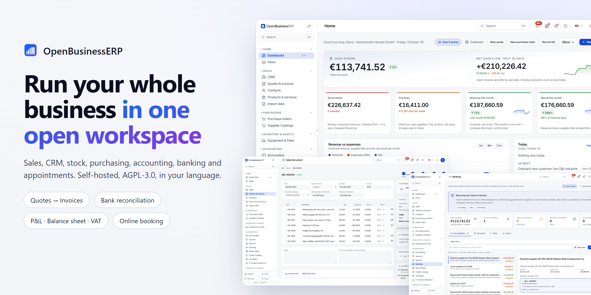
</p>

<h1 align="center">OpenBusinessERP</h1>

<p align="center"><b>An open-source, self-hosted ERP for small and mid-sized businesses, from the first quote to the closed accounting period.</b></p>

<p align="center">
  <a href="LICENSE"></a>
  
  
  
  
  
</p>

<p align="center">
  <a href="#quick-start">Quick start</a> ·
  <a href="#a-tour-of-the-workspace">Feature tour</a> ·
  <a href="#architecture">Architecture</a> ·
  <a href="#configuration">Configuration</a> ·
  <a href="#faq">FAQ</a> ·
  <a href="#contributing">Contributing</a>
</p>

---

OpenBusinessERP is a free, open-source ERP (enterprise resource planning) system for small and mid-sized companies. It covers quotes and invoicing, CRM, products and stock, purchasing, double-entry accounting, bank reconciliation, receivables and appointments in a single web application that you host yourself. It is a modular business suite you can run on your own server, adapt and extend.

## Who it's for

- **Trading and wholesale companies** that buy, stock and resell goods and need quotes, orders, invoices, purchase orders and stock in one place.
- **Service businesses** that sell time or fixed-price services, book appointments and invoice them.
- **Small teams without an IT department.** One command starts the server with an embedded database and a demo company to explore.
- **Companies that want their own data.** Everything runs on your hardware or your cloud account; there is no vendor-hosted tenant.
- **Developers and integrators** who want a FastAPI + React codebase with a documented REST API and a module system to build on.

It is not a replacement for a certified payroll package or for the statutory filings your accountant submits; see the [disclaimer](#disclaimer).

## Why OpenBusinessERP

Most small companies run on a patchwork: one tool for quotes, another for invoices, a spreadsheet for stock, the bank portal for payments and an accountant who re-types it all. OpenBusinessERP connects these steps in one flow.

- **One document chain.** A quote becomes an order, the order becomes an invoice, and the invoice is posted to the general ledger and shows up in receivables. Nothing is typed twice.
- **Real bookkeeping, not just invoicing.** Double-entry general ledger, journal, trial balance, balance sheet, profit & loss, VAT return and period close.
- **The bank closes the loop.** Import a statement, let matching rules propose the invoice or bill behind each line, confirm.
- **Yours to run.** Self-hosted under AGPL-3.0, with an embedded PostgreSQL, so one command gives you a working system. No per-seat licences, and your data stays on your server.
- **In your language.** The interface ships with 45 locale bundles, and documents can be issued in the customer's language.

## A tour of the workspace

Every screenshot below shows the real application running the bundled demo company, *Kestrelmark Handel GmbH* (a wholesale trader, EUR).

### Dashboard

Cash in bank, receivables, payables, revenue and net result at a glance, plus a cash-flow outlook, a revenue-versus-expenses chart, today's agenda and recent activity.


### Sales: quotes, orders, invoices and credit notes

One list covers the whole sales cycle, with status filters, overdue tracking and totals.

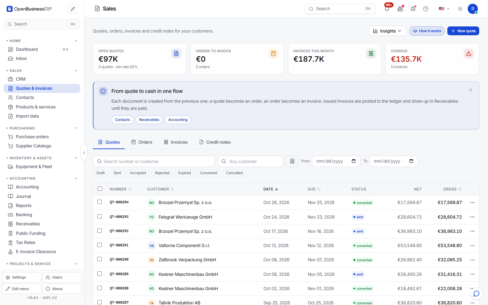

Each document shows where it is in the *Quote → Order → Delivered → Invoiced → Paid* chain, along with its line items, payments, related documents and activity log. Documents go out as PDF by email, and e-invoices can be produced as CII XML.

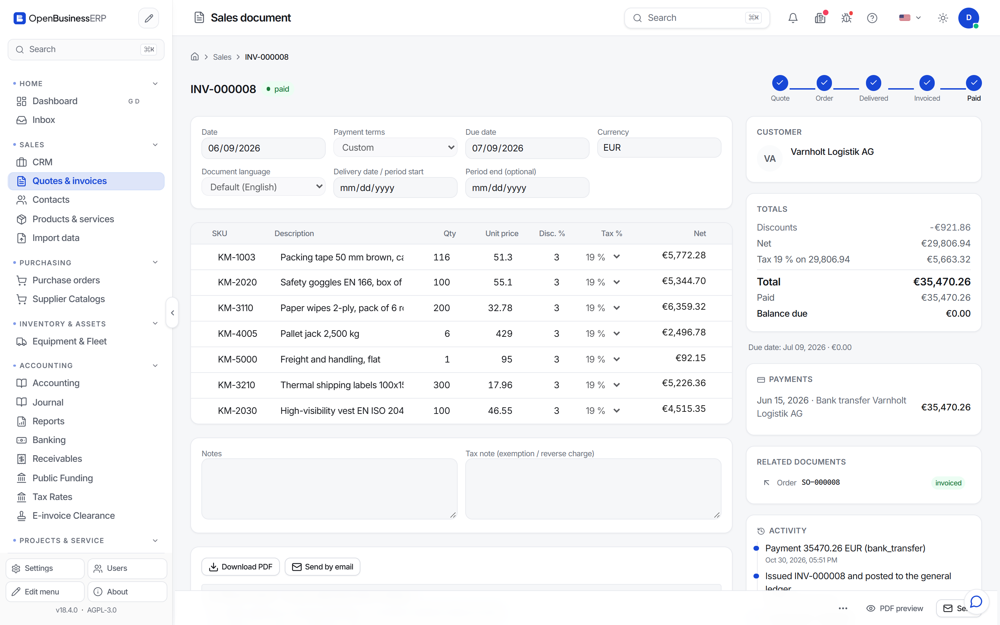

### CRM

A pipeline board takes deals from lead to won and links them to contacts and companies. A won deal becomes a quote in one click.


### Products, services and stock

One catalogue holds everything you sell or buy: SKU, unit, sales price, cost, margin, tax rate and stock on hand, with minimum-stock alerts and CSV export.

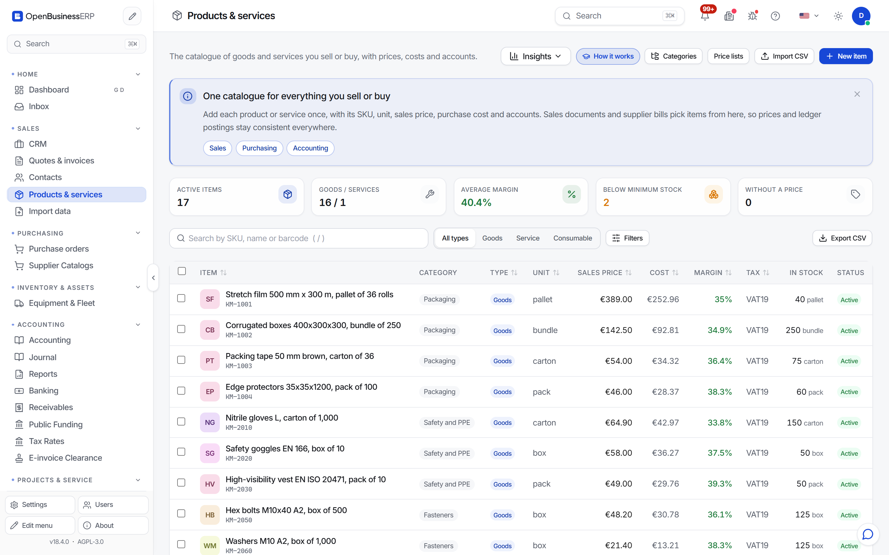

### Purchasing

Purchase orders, goods receipts and supplier bills are matched step by step, so you pay only for what was ordered and received. Supplier catalogues keep supplier prices next to your own items.

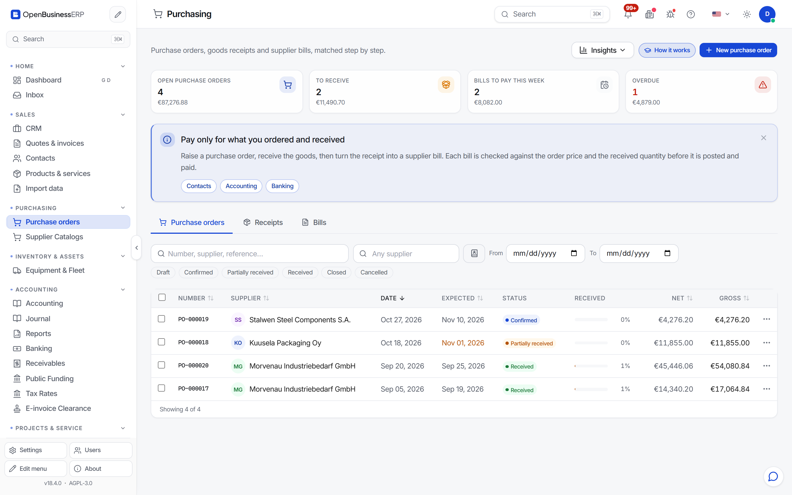

### Banking and reconciliation

Import bank statements (CSV, MT940, camt) and reconcile them in a two-pane workspace: open statement lines on the left, suggested invoices and bills on the right. Rules categorise recurring lines such as fees or salaries automatically.


### Receivables and dunning

Aging buckets show who owes you and how overdue each balance is. A dunning run proposes a reminder level per customer, and you can exclude individual customers.

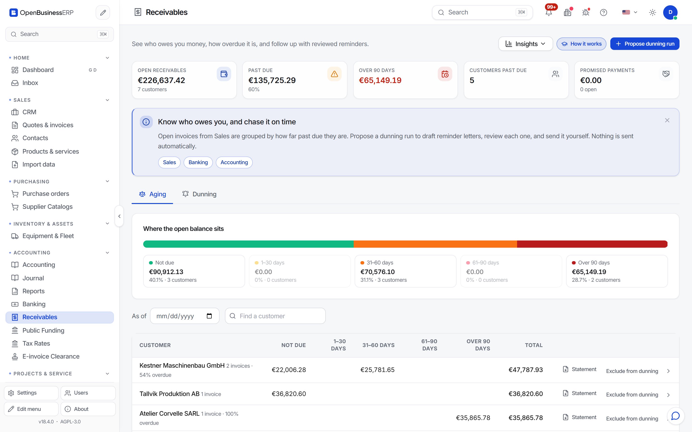

### Accounting

Sales and purchase documents post to the ledger automatically. You can review the journal, add manual entries, maintain the chart of accounts and close periods.

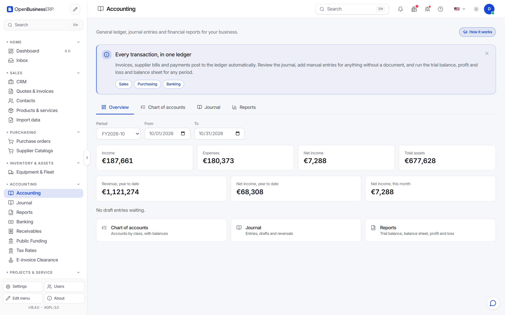

The reports are trial balance, balance sheet, profit & loss (with comparison to the previous period) and VAT return. All of them export to CSV.

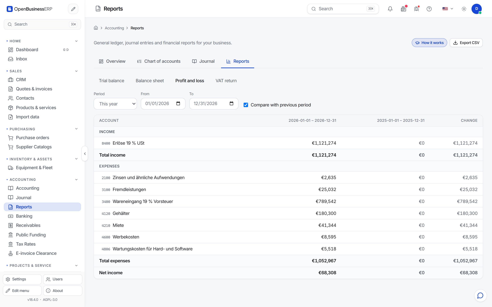

### Appointments and online booking

Plan services, staff and rooms on a calendar, and publish a public booking page (`/book/<slug>`) that customers open directly or that you embed on your website. A completed booking can be invoiced in one click.

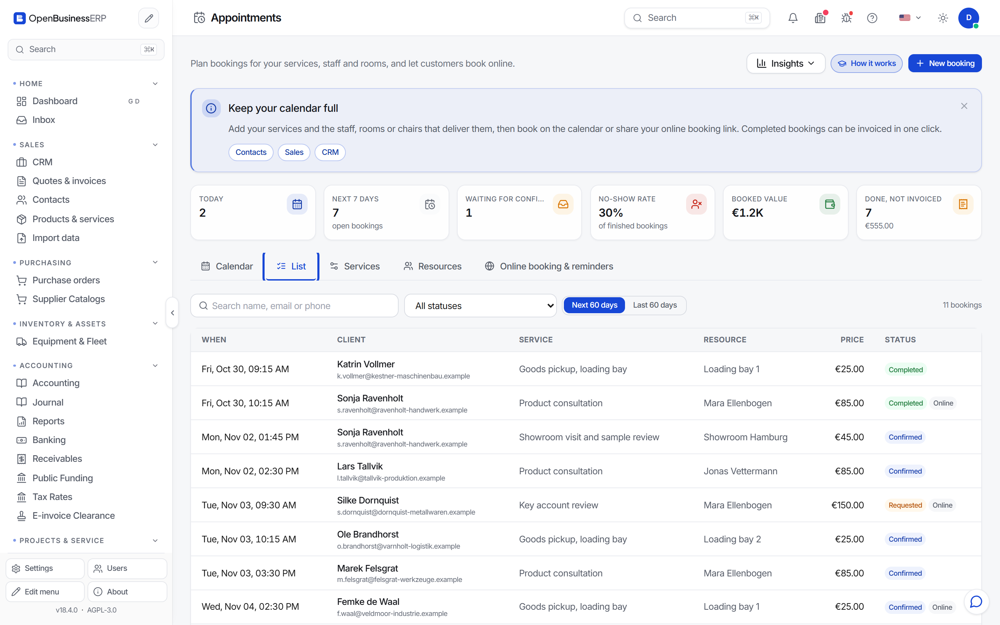

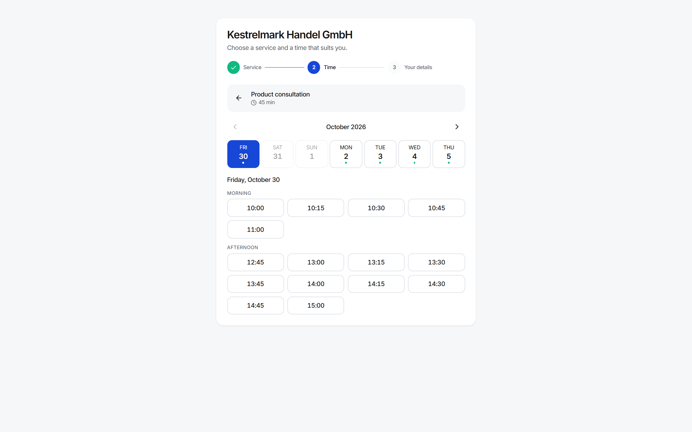

### Data import

Move in from spreadsheets or another system. A wizard imports customers, suppliers, products, opening balances and open invoices from CSV or XLSX. It maps the columns, validates the rows, runs a dry run first, and lets you undo an import.

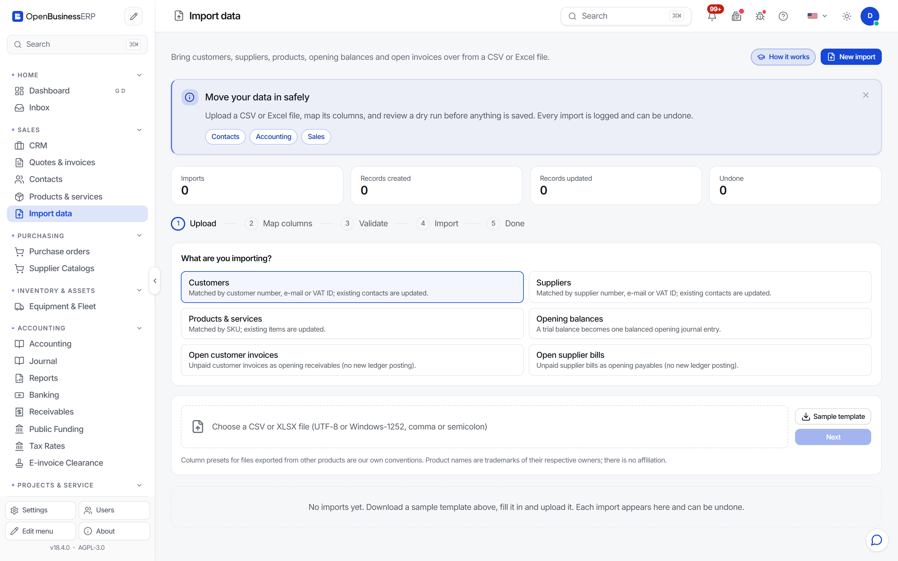

### Settings and modules

Company and document settings, regional formats, team and roles, e-invoicing, AI providers, integrations and the module switchboard all live in one settings hub. The *Simple* interface mode shows only the essentials; *Advanced* shows every module.

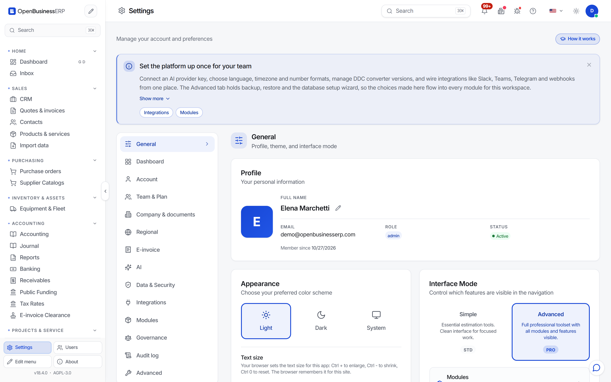

### AI chat

Ask about your own data in plain language, for example "which invoices are overdue?" or "what did we buy from this supplier last quarter?". You bring your own API key: Anthropic, OpenAI, Gemini, Mistral, Groq and other providers can be configured in Settings. Without a key, everything else works as usual.

### Projects and service

Projects, service cases and tasks support companies that deliver work as well as goods.

## Architecture

```
┌──────────────────────────────┐      ┌───────────────────────────────────────────┐
│  React 18 + TypeScript (SPA) │ HTTP │  FastAPI application (Python 3.12+)       │
│  Vite · Tailwind · TanStack  │ ───► │  ├─ core: auth, settings, module loader   │
│  Query · Zustand · i18next   │ JSON │  └─ app/modules/<name>/manifest.py        │
└──────────────────────────────┘      │      sales · crm · items · purchasing ·   │
                                      │      gl · banking · receivables · ...     │
                                      └──────────────────┬────────────────────────┘
                                                         │ SQLAlchemy 2 (async) + Alembic
                                                 ┌───────▼────────┐
                                                 │   PostgreSQL   │  embedded by default,
                                                 └────────────────┘  or your own server
```

- **Backend:** FastAPI, SQLAlchemy 2 (async), Pydantic 2 and Alembic migrations.
- **Frontend:** React 18, TypeScript, Vite, Tailwind CSS, TanStack Query, Zustand and i18next. The production build is bundled into the Python wheel and served by the backend.
- **Modules:** each business area is a Python package under `backend/app/modules/` with a `manifest.py`. The module loader discovers the manifests, resolves dependencies and registers each module's models, routes and event hooks. Modules can be switched on or off per installation.
- **Database:** PostgreSQL. A fresh install starts an embedded PostgreSQL in the data directory, so you don't need a separate database server. For production, point `DATABASE_URL` at your own server.

## Quick start

### Docker (recommended)

```bash
git clone https://github.com/datadrivenconstruction/OpenBusinessERP.git
cd OpenBusinessERP
echo "POSTGRES_PASSWORD=$(openssl rand -base64 24)" >  .env
echo "JWT_SECRET=$(openssl rand -hex 32)"           >> .env
make quickstart
```

Open **http://localhost:8080**. The first start builds the image, creates the database and loads the demo company. `docker-compose.prod.yml` is the production template. See [docs/getting-started.md](docs/getting-started.md) for details.

### Local development

```bash
git clone https://github.com/datadrivenconstruction/OpenBusinessERP.git
cd OpenBusinessERP
pip install -e "./backend[server]"
cd frontend && npm install && cd ..

# Terminal 1: API with an embedded PostgreSQL
cd backend && openbusinesserp serve --embedded-pg --port 8000
# Terminal 2: frontend with hot reload
cd frontend && npm run dev
```

Open **http://localhost:5173**. You need Python 3.12+ and Node.js 22+.

### pip (from the first PyPI release)

Once the first release is on PyPI, a single command installs the backend together with the pre-built frontend:

```bash
pip install --upgrade openbusinesserp
openbusinesserp            # embedded PostgreSQL, demo company, opens http://localhost:8080
openbusinesserp doctor     # OK/WARN/ERROR report per check
```

### Demo login

On a local install, the sign-in page offers one-click demo accounts. The administrator account is `demo@openbusinesserp.com`. The `SEED_DEMO` setting controls the demo data and the demo sign-in. **Set `SEED_DEMO=false` on any server that is reachable from the internet.**

## Configuration

Settings are read from environment variables or a `.env` file. [`backend/.env.example`](backend/.env.example) has the full annotated list. The most important ones:

| Variable | Purpose |
|---|---|
| `DATABASE_URL` | PostgreSQL connection (`postgresql+asyncpg://...`). Leave it unset to use the embedded database. |
| `JWT_SECRET` | Random string of 32+ characters. Required in production. |
| `SEED_DEMO` | `true` loads the demo company and the demo sign-in. Set it to `false` in production. |
| `S3_*` | Optional S3-compatible file storage. Local disk is used otherwise. |

AI providers, e-mail, e-invoicing, company data and number formats are configured in the app under **Settings**.

## Languages and regions

- **Interface:** 45 locale bundles in `frontend/src/app/locales/`. They include right-to-left languages (Arabic, Hebrew, Persian, Urdu) and regional variants such as `en-GB`, `pt-BR` and `es-MX`.
- **Documents:** quotes and invoices can be issued in a language other than the one the user works in.
- **Regional formats:** currency, date and number formats and tax rates are set per company.

## FAQ

**Can I self-host it?**
Yes, self-hosting is the only way to run it. Use Docker Compose (`make quickstart`, with `docker-compose.prod.yml` as the production template) or install the Python package and run `openbusinesserp serve`. Without `DATABASE_URL`, an embedded PostgreSQL is started in the data directory; for production, point it at your own PostgreSQL server.

**What does it cost, and what is the license?**
The software is free under the AGPL-3.0. There are no per-user fees. If you modify it and offer it to others over a network, you must publish your changes under the same license. A commercial license is available on request.

**Which languages are supported?**
The interface ships with 45 locale bundles, including right-to-left languages. Quotes and invoices can be issued in the customer's language, independently of the language the user works in.

**Which chart of accounts does it use?**
Two templates are included: a generic IFRS-style chart and the German SKR03. Accounts can be added, renamed or deactivated afterwards.

**How do I move my data in?**
The import wizard reads CSV and XLSX files for customers, suppliers, products, opening balances, open invoices and open bills. Export these lists from your current tool or spreadsheet, map the columns, check the dry run, then import. An import can be undone.

**Does it handle e-invoicing?**
Invoices can be exported as CII XML. Check the generated files against the rules that apply to you; see the [disclaimer](#disclaimer).

**Is there an API?**
Yes. The backend is a FastAPI application, and every screen in the UI uses the same REST API under `/api/v1/`. Outside production mode the backend also serves the OpenAPI schema (`/api/openapi.json`) with interactive docs.

**Do I need an AI provider?**
No. The AI chat is optional and uses your own API key. Without a key, every other feature works.

## Contributing

Bug reports, translations and pull requests are welcome. Please read [CONTRIBUTING.md](CONTRIBUTING.md) first; contributors sign the [CLA](CLA.md) once, via a bot comment on the first pull request. For anything larger than a bug fix, open an issue to discuss the approach before you start.

## License

OpenBusinessERP is licensed under the [GNU Affero General Public License v3.0](LICENSE). You can use, modify and self-host it freely. If you offer a modified version to users over a network, you must make its source code available to them under the same license. A commercial license is available on request. See also [NOTICE](NOTICE), [TRADEMARK.md](TRADEMARK.md), [PRIVACY.md](PRIVACY.md) and [SECURITY.md](SECURITY.md).

## Disclaimer

OpenBusinessERP is provided **"AS IS", without warranty of any kind**, express or implied, and without liability for damages, to the extent permitted by law (see sections 15 and 16 of the [AGPL-3.0](LICENSE)).

- **Not professional advice.** Nothing in the software or its documentation is tax, legal or accounting advice. Consult a qualified adviser for your situation.
- **You verify the rules.** Tax rates, VAT and sales-tax logic, e-invoice formats (for example XRechnung, ZUGFeRD, Peppol), statutory reports and retention rules are shipped as a starting point and change over time. You are responsible for checking them against current law and the official specifications before relying on them, and for any filing or invoice you issue.
- **Schema-validated is not certified.** Where the software validates documents against a published schema, that confirms the structure only. No part of OpenBusinessERP is certified by a tax authority or standards body unless explicitly stated.
- **Fictional demo data.** All demo companies, people, addresses, bank details and tax numbers are invented. Any resemblance to real organisations or persons is coincidental.

<p align="center"><sub>Made by <a href="https://datadrivenconstruction.io">Data Driven Construction</a>.</sub></p>
