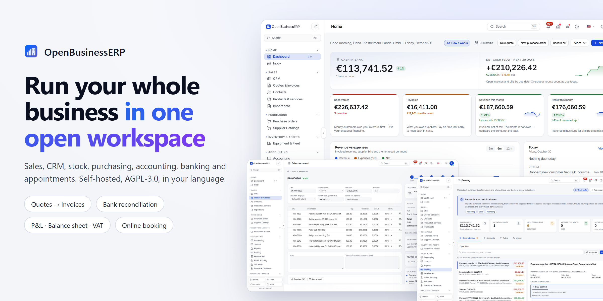
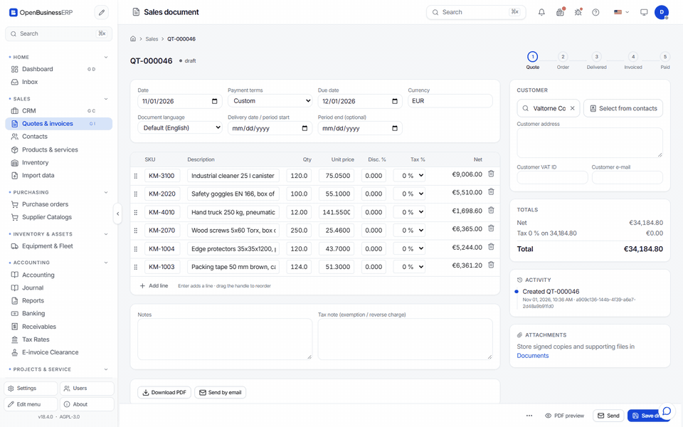

<h1 align="center">OpenBusinessERP</h1>

<p align="center">Self-hosted ERP for small businesses in Germany, Austria and Switzerland: quotes, invoices, stock, purchasing, bank reconciliation and double-entry bookkeeping, with a DATEV export for your tax adviser.</p>

<p align="center">
  <a href="LICENSE"></a>
  <a href="https://github.com/datadrivenconstruction/OpenBusinessERP/tags"></a>
  <a href="https://github.com/datadrivenconstruction/OpenBusinessERP/actions/workflows/ci.yml"></a>
</p>

<p align="center">
  <a href="https://openbusinesserp.com">Website</a> ·
  <a href="https://demo.openbusinesserp.com/">Live demo</a> ·
  <a href="https://datadrivenconstruction.github.io/OpenBusinessERP/">Documentation</a> ·
  <a href="#quick-start">Quick start</a> ·
  <a href="#limits">Limits</a> ·
  <a href="ROADMAP.md">Roadmap</a>
</p>

<p align="center">
  
</p>

*Auf Deutsch:* Angebote, Rechnungen mit XRechnung/ZUGFeRD, Bankabgleich, Buchhaltung nach SKR03 oder SKR04 und DATEV-Export. Läuft auf Ihrem eigenen Server, Quellcode offen unter AGPL-3.0.

## A month in the software

The demo company, *Kestrelmark Handel GmbH*, is a wholesale trader. A typical month:

1. A customer asks for a price. You write an **Angebot** (quote) and send it as PDF from your own mail server.
2. The customer accepts. The quote becomes an **Auftrag** (order), then a **Lieferschein** (delivery) that takes the goods out of stock.
3. The delivery becomes a **Rechnung** (invoice) with a SEPA GiroCode, or a Swiss QR-bill for CH/LI businesses. For a public-sector customer you export it as XRechnung from the invoice page, with the Leitweg-ID on the invoice. Posting the invoice writes the journal entry on SKR03 or SKR04, split by VAT rate.
4. Stock runs low. A **Bestellung** (purchase order) goes to the supplier; the goods receipt and the supplier's **Eingangsrechnung** (bill) are matched against it.
5. You import the bank statement (camt.053, MT940 or CSV). The **Bankabgleich** proposes the open invoice or bill behind each line; you confirm.
6. A customer has not paid. The dunning run proposes a **Mahnung** level and sends the reminder by e-mail.
7. At month end you check the VAT report, close the period and download the **DATEV Buchungsstapel** for your tax adviser.

<p align="center">
  
</p>

## Features

**Sales**
- Quotes, orders, deliveries, invoices and credit notes in one document chain; nothing is typed twice.
- Recurring invoices (weekly to yearly) that are generated, posted and e-mailed on schedule, with MRR and ARR.
- Payment links on invoices through Stripe or Mollie; the provider fee is booked when the webhook reports it.
- Documents in the customer's language, independent of the user's interface language; the interface ships with 45 locale bundles.

**Customers and appointments**
- CRM pipeline from lead to won deal; a won deal becomes a quote.
- Calendar for services, staff and rooms, with a public booking page you can embed on your website.

**Stock and purchasing**
- Product and service catalogue with prices, margins, tax rates and minimum stock.
- Stock per warehouse in a movement ledger, stocktakes, moving-average valuation.
- Purchase order, goods receipt and supplier bill matched step by step; supplier price catalogues.

**Bank and receivables**
- Statement import in camt.053, camt.054, MT940 and CSV; matching rules for recurring lines.
- Aging buckets and dunning runs with per-customer exclusions.

**Accounting**
- Double-entry general ledger: journal, trial balance, balance sheet, profit and loss with prior-period comparison, VAT report.
- Posted entries cannot be edited, only reversed. Closed periods accept no postings. Entry numbers are gap-free per fiscal year. Every business-module write is recorded in an audit log with a before/after summary.
- Multi-currency with ECB reference rates; realised exchange differences are posted.

**Getting data in and out**
- Import wizard for customers, suppliers, products, opening balances and open items from CSV or XLSX, with dry run and undo.
- REST API under `/api/v1/` with an OpenAPI schema; every screen uses the same API.
- Optional AI chat over your own data, using your own API key. Everything else works without it.

## Germany, Austria, Switzerland

| Topic | What the code does |
|---|---|
| Charts of accounts | SKR03 and SKR04 (DE), Einheitskontenrahmen EKR (AT), KMU-Kontenrahmen (CH), plus an IFRS-style chart. Pick one in the business setup. |
| VAT | Sales and purchase VAT post per rate (19 % / 7 % on SKR03 and SKR04). 0 % lines are routed to the reverse-charge (§ 13b), intra-EU, § 19 UStG small-business or exempt revenue account. AT 13 % and CH 3.8 % rates and the Swiss Art. 10 MWSTG exemption are available in the setup. |
| E-invoicing | XRechnung 3.0 (CII), ZUGFeRD 2.1 / Factur-X hybrid PDF, EN 16931 CII and UBL, Peppol BIS Billing 3.0. Invoices are checked against EN 16931 business rules before export. |
| DATEV | EXTF Buchungsstapel with all 125 columns, Debitor/Kreditor personal accounts, tax-account folding, Skonto, foreign-currency fields and Beleglink; Debitoren/Kreditoren master data file. SAF-T 2.0 XML as well. |
| Payment slips | SEPA GiroCode (EPC QR) on EUR invoices; Swiss QR-bill (SIX guidelines v2.3, structured addresses, QR-IBAN with QRR reference) as the A6 payment part for CH/LI businesses. |
| Bookkeeping rules | Posted entries are immutable and corrected by reversal; closed periods are locked; numbering is gap-free; changes are audit-logged. These are the properties GoBD asks for, not a GoBD certification (see below). |

## Quick start

You need Docker with Compose v2, Git and `make`.

```bash
git clone https://github.com/datadrivenconstruction/OpenBusinessERP.git
cd OpenBusinessERP
echo "POSTGRES_PASSWORD=$(openssl rand -base64 24)" >  .env
echo "JWT_SECRET=$(openssl rand -hex 32)"           >> .env
make quickstart
```

Open <http://localhost:8080>. The first start builds the image, creates the database and loads the demo company; the sign-in page offers one-click demo accounts. If you do not want to build locally, `make quickstart-image` uses the published image.

Before the server is reachable from the internet: set `SEED_DEMO=false`, put a reverse proxy with HTTPS in front of port 8080, and start from `docker-compose.prod.yml`. Details, the desktop app and backups are in the [install guide](docs/manual/install.md).

For development (Python 3.12+, Node.js 22+):

```bash
pip install -e "./backend[server]"
# terminal 1: API with an embedded PostgreSQL
cd backend
openbusinesserp serve --embedded-pg --port 8000
# terminal 2: UI with hot reload on http://localhost:5173
cd frontend && npm install && npm run dev
```

See [DEVELOPING.md](DEVELOPING.md) and the [module development quickstart](docs/module-development/quickstart.md).

## Limits

Read these before you rely on the software for your books.

- **Nothing is certified.** The DATEV files are not certified by DATEV. The e-invoices are checked against EN 16931 rules, which confirms structure, not acceptance by a receiver or authority. The software is not certified as GoBD-compliant; GoBD compliance also depends on your procedures documentation (Verfahrensdokumentation), retention and operation.
- **Test the DATEV export with your tax adviser** before the first real import. Adviser and client number, account length and SKR must match their setup. Columns without a data source stay empty. The full list is in [DATEV and SAF-T export](docs/manual/accountant-export.md).
- **ZUGFeRD PDFs are not strict PDF/A-3b.** The embedded XML is complete; a receiver that demands PDF/A-3b needs a post-processing step.
- **No payroll, no tax filing.** There is no Lohnabrechnung, no ELSTER submission of the VAT return and no annual financial statement (Jahresabschluss) workflow. Your accountant files.
- **No GitHub release yet.** Docker from source is the supported path. The desktop installers are not code signed, and the PyPI package is not published.
- **Bank connection is file-based.** Statements are imported as files; there is no live FinTS/EBICS or PSD2 connection.

## Architecture

FastAPI, SQLAlchemy 2 (async), Pydantic 2 and Alembic on PostgreSQL; a React 18 + TypeScript single-page app built with Vite and served by the backend. Each business area is a module under `backend/app/modules/<name>/` with a `manifest.py`; the loader resolves dependencies and registers models, routes and event hooks, and modules can be switched off per installation. Without `DATABASE_URL`, an embedded PostgreSQL is started in the data directory. Configuration is read from environment variables; [`backend/.env.example`](backend/.env.example) lists them all.

The interface ships with 45 locale bundles, including right-to-left scripts.

## Contributing

Bug reports, translations and pull requests are welcome. Read [CONTRIBUTING.md](CONTRIBUTING.md) first; contributors sign the [CLA](CLA.md) once, through a bot comment on the first pull request. For anything larger than a bug fix, open a [discussion](https://github.com/datadrivenconstruction/OpenBusinessERP/discussions) about the approach before you start. Report security issues privately as described in [SECURITY.md](SECURITY.md).

## License

OpenBusinessERP is licensed under the [GNU Affero General Public License v3.0](LICENSE). You can use, modify and self-host it freely. If you offer a modified version to users over a network, you must make its source code available to them under the same license. A commercial license is available on request. See also [NOTICE](NOTICE), [TRADEMARK.md](TRADEMARK.md) and [PRIVACY.md](PRIVACY.md).

## Disclaimer

OpenBusinessERP is provided **"AS IS", without warranty of any kind**, express or implied, and without liability for damages, to the extent permitted by law (see sections 15 and 16 of the [AGPL-3.0](LICENSE)).

- **Not professional advice.** Nothing in the software or its documentation is tax, legal or accounting advice. Consult a qualified adviser for your situation.
- **You verify the rules.** Tax rates, VAT logic, e-invoice formats, statutory reports and retention rules are shipped as a starting point and change over time. You are responsible for checking them against current law and the official specifications before relying on them, and for any filing or invoice you issue.
- **Schema-validated is not certified.** Where the software validates documents against a published schema, that confirms the structure only. No part of OpenBusinessERP is certified by a tax authority or standards body unless explicitly stated.
- **Fictional demo data.** All demo companies, people, addresses, bank details and tax numbers are invented. Any resemblance to real organisations or persons is coincidental.

<p align="center"><sub>Made by <a href="https://datadrivenconstruction.io">Data Driven Construction</a>.</sub></p>
