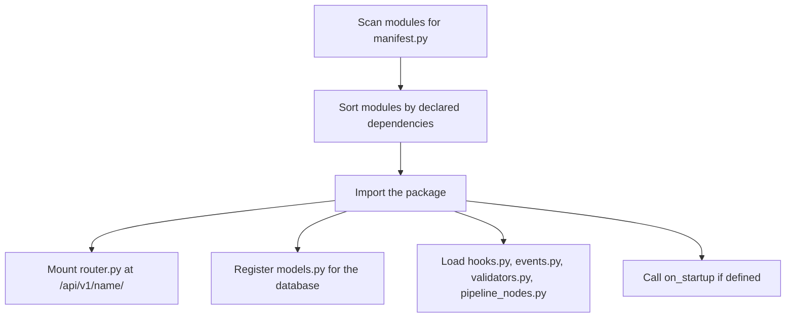

# Architecture overview

OpenBusinessERP is an open, modular ERP for small and
medium businesses, published by DataDrivenConstruction under AGPL-3.0 with a
commercial option for enterprises. This page is the entry point to the architecture
docs. It explains how the codebase fits together: the monorepo layout, the module
system, the validation pipeline, the data stores, and the
split between the backend and the frontend. It describes the platform at the version
declared in `backend/pyproject.toml`, which read 16.2.0 when this page was last checked.
That file is the one authority on the version, so read it there rather than trusting the
number here.

## Design principles

A few ideas shape every part of the code:

- **Lightweight and simple.** One required dependency, PostgreSQL. The core runs on a
  small VPS or on a laptop.
- **Modules are plugins.** Every backend feature is a self-contained package that the
  loader discovers and mounts automatically. A module is a directory under
  `backend/app/modules/` carrying a `manifest.py`, and there were 189 of them at the last
  count: `ls backend/app/modules/*/manifest.py | wc -l`. A handful of further directories
  sit alongside them as plain helper packages that other modules import, so counting
  directories rather than manifests overcounts.
- **Validation is not optional.** Imported and edited data passes through a rule-based
  validation step that is part of the core workflow, not an afterthought.
- **Assisted, human-confirmed.** The platform suggests values, such as categories and
  matches, with confidence scores. A person reviews and confirms before anything is
  applied. Nothing is auto-applied.
- **Open data.** Your data is exportable in open formats such as Excel, CSV and JSON.

## Technology at a glance

| Layer | What we use |
|-------|-------------|
| Backend API | Python 3.12 with FastAPI, Pydantic v2, async SQLAlchemy |
| Frontend | React 18 with TypeScript, built by Vite, styled with Tailwind |
| Frontend state | Zustand for global state, React Query for server state |
| Database | PostgreSQL only (embedded PostgreSQL 16 for local dev) |
| Vector search | Qdrant, or an embedded in-process store for local installs |
| File storage | Local filesystem, or any S3-compatible bucket such as MinIO |
| Desktop | An optional desktop shell wraps the same backend and frontend |

## Monorepo layout

| Path | What lives here |
|------|-----------------|
| `backend/` | The FastAPI application: app factory, settings, the core framework, and every business module |
| `frontend/` | The React single-page application |
| `packages/oe-sdk/` | Python SDK for building modules outside the main tree |
| `modules/` | Community and example modules, including the module template |
| `data/` | Seed data: classifications, templates, and rule packs |
| `desktop/` | Desktop shell and installer build |
| `deploy/` | Deployment configs (Docker, Railway, Render, Terraform) |
| `docs/` | Architecture and developer documentation |
| `scripts/`, `tools/` | Maintenance, build, and data helpers |

## Backend and frontend split

The **backend** is a FastAPI application under `backend/app/`. `main.py` is the app
factory: it configures logging and middleware, mounts a few system routes, and asks the
module loader to discover and mount every module. `config.py` holds typed settings,
`database.py` builds the async SQLAlchemy engine and session, and `dependencies.py`
wires request-scoped dependencies such as the current user and role checks. The request
pipeline (CORS, security headers, request correlation id, locale) lives in
`middleware/`. The reusable framework, the parts that are not tied to any one feature,
lives in `core/`: the module loader, the event bus, the hook registry, the validation
engine, the RBAC permission engine, storage, vector search, and i18n. Business features
live in `core/`'s sibling, `modules/`.

The **frontend** is a React single-page application under `frontend/src/`. `app/`
holds the shell, routing, layout, and i18n setup. `features/` holds the feature folders
that mirror the backend modules, 180 of them at the last count
(`ls -d frontend/src/features/*/ | wc -l`). `shared/` holds the design-system UI
components, hooks, utilities, the generated API client, and auth helpers. `stores/`
holds the Zustand stores. `modules/` holds an in-app registry for the optional plugin
modules, which declare their routes from a single manifest; see "Adding a screen to the
frontend" below for what that registry does and does not do for you. Heavy pages
are code-split and loaded on demand.

## The module system

Each backend module is a folder under `backend/app/modules/<name>/` with a `manifest.py`
that defines a `ModuleManifest`: its name, version, display name, category, declared
dependencies, and whether it installs by default. On startup the loader does the same
thing for every module, by convention rather than configuration:

A module's router auto-mounts at `/api/v1/<module>/` (kebab-case is the canonical URL,
with the underscore form kept as a legacy alias). Its models auto-register so database
migrations pick them up. Its hooks, events, and validators load automatically if the
files exist. Core modules are always on: the loader refuses to disable a manifest whose
`category` is `core`, and that was 119 of the 189 manifests at the last count. Everything
else, among them the business, regional, extension, controls and enterprise categories,
can be enabled or disabled at runtime, and the choice is persisted, so a workspace only
carries what it needs. To see the current split, run
`grep -rhoE 'category="[a-z_]+"' backend/app/modules/*/manifest.py | sort | uniq -c`.

## Adding a screen to the frontend

The backend story above is genuinely drop-in: put the package in place, restart, and the
loader finds it. The frontend is not one system but two, and they differ in how much they
register for you. Reading only the backend paragraph and assuming it carries over is the
usual way to lose an afternoon here.

**Feature folders** under `frontend/src/features/` are the large majority of the product,
180 directories at the last count. Nothing discovers them. Each one is wired by hand in
`frontend/src/app/App.tsx`, which imports the page, usually through a `lazy()` call, and
gives it an explicit `<Route path=...>` entry. There were 280 of those entries at the last
count: `grep -c '<Route path=' frontend/src/app/App.tsx`. The sidebar row is maintained
separately again, in the screen catalogue at `frontend/src/app/layout/navCatalog.ts`,
which carried 142 rows: `grep -cE "^ +\{ .*to: '" frontend/src/app/layout/navCatalog.ts`.
Adding a feature therefore means a folder, plus an import, plus a route, plus a nav row.

**Plugin modules** under `frontend/src/modules/` are the smaller, opt-in set: 17 of them,
one `manifest.ts` each, listed in `frontend/src/modules/_registry.ts`. The other directory
there, `_shared/`, holds helpers rather than a module. These come closer to drop-in but do
not reach it. A new one needs its folder and two hand-written lines in `_registry.ts`, an
import of the manifest and an entry in the `MODULE_REGISTRY` array. Once it is in that
array its routes really are automatic: `useModuleRouteElements` walks the registry and
mounts a route for every enabled module without anyone naming it. Its sidebar row is not.
The registry still exposes `getModuleNavItems`, and the sidebar still calls it for a group
that asks for one, but the shipped manifests have moved away from it. Fifteen of the 17
declare `navItems: []`, and the two that do declare a row name groups that
`navCatalog.ts` deliberately no longer uses, so those two screens are listed in the
catalogue by hand like any feature. Treat the sidebar as hand-maintained in both systems
and you will not be surprised.

So the rule of thumb is this. On the backend, a folder is enough. On the frontend, a
plugin module gets its routes for free after two lines in the registry, a feature folder
gets nothing for free, and neither gets a sidebar entry without an edit to
`navCatalog.ts`.

## Events and hooks

Modules stay decoupled through two mechanisms in `core/`. The **event bus**
(`core/events.py`) is publish and subscribe with dot-notation names such as
`invoice.created` or `payment.received`. A module publishes an event and any
other module can subscribe to it, with no direct import between them. Handlers can be
sync or async, and a detached-publish variant lets a request commit before its
subscribers run. **Hooks** (`core/hooks.py`) come in two kinds: filters run data through
a priority-ordered chain and return the transformed value, while actions are
fire-and-forget side effects at a named point. Filters propagate errors because they are
part of the data path; actions log and swallow errors because they are side effects.

## Validation pipeline

Validation is a first-class citizen, not an add-on. The engine lives in
`core/validation/`. A `ValidationRule` declares an id, the standard it belongs to, a
severity (error, warning, or info), and a category (structure, completeness,
consistency, compliance, quality, custom, or diagnostic, the last being an engine or
infrastructure failure rather than a compliance finding). Rules are grouped into named
rule sets
such as the accounting and VAT sets, plus regional sets. The engine runs the selected rule sets over
the data and returns a `ValidationReport` with an overall status, a severity-weighted
quality score from 0.0 to 1.0, and one result per checked element that links back to its
source, whether that is an invoice line, a product, or a contact. The UI shows the
report as a traffic-light dashboard: green for passed, amber for warnings, red for
errors. A blocking error caps the score so a single fatal issue can never read as high
quality.

## Data stores

PostgreSQL is the single required dependency. For local development and the desktop
build the app starts an embedded PostgreSQL 16, so there is no Docker and no separate
database to run; set `DATABASE_URL` to point at an external PostgreSQL for a server
deployment. SQLite support was removed in v6.6.0, so the code is PostgreSQL only.

Two optional stores add capability without becoming hard requirements:

- **Vector search** powers semantic matching and cross-module search. It runs on
  Qdrant by default, which is recommended for servers, or on an embedded in-process
  vector store for a zero-config local install. If no vector backend is reachable the
  platform still boots and only the semantic features are disabled.
- **File storage** for uploaded documents, attachments, and generated
  reports goes through a storage abstraction. It writes to the local filesystem by
  default, or to any S3-compatible bucket such as MinIO, selected by the
  `STORAGE_BACKEND` setting.
