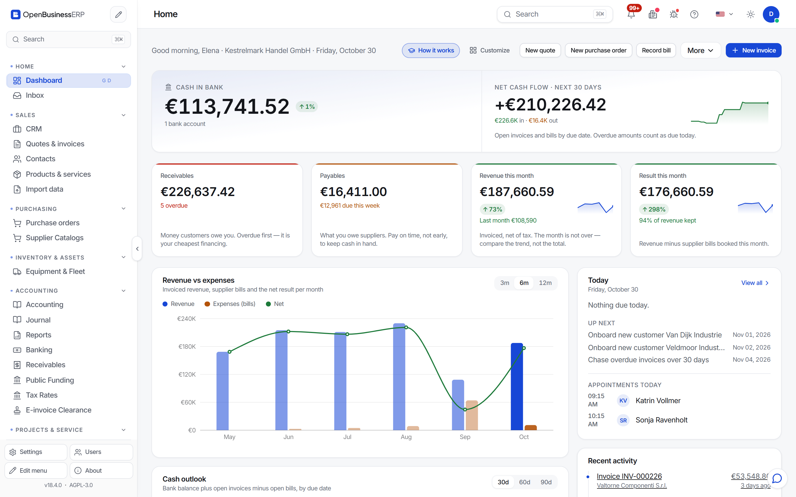

# OpenBusinessERP

OpenBusinessERP is a free ERP system that you run yourself. It covers quotes and invoices, customers, stock, purchasing, bank reconciliation and double-entry accounting. It is licensed under the AGPL-3.0.

This manual is for the owner of a small business and for the accountant who works with them. It explains tasks, one at a time, using screens from the bundled demo company.

## Where to start

| You want to | Read |
|---|---|
| Run the program | [Install](manual/install.md) |
| Enter your company and send an invoice | [Set up and send your first invoice](manual/first-invoice.md) |
| Move from quote to paid invoice | [Quote, order, delivery, invoice](manual/sales-flow.md) |
| Bill the same customer every month | [Recurring invoices](manual/recurring.md) |
| Match bank lines to invoices | [Banking and reconciliation](manual/banking.md) |
| Chase late payers | [Dunning](manual/dunning.md) |
| Give your accountant the books | [DATEV and SAF-T export](manual/accountant-export.md) |
| Protect your data | [Backup and restore](manual/backup.md) |

## What this manual does not do

- It is not tax or accounting advice. Tax rates, VAT rules and e-invoice formats change. Check them with your tax adviser.
- It describes what the software does today. Where a feature has limits, the page says so.
- It does not cover every module. The program contains many more modules than a small business needs. The pages here cover the business workflow only.

## Getting help

- Questions and ideas: [GitHub Discussions](https://github.com/datadrivenconstruction/OpenBusinessERP/discussions)
- Bugs: [GitHub Issues](https://github.com/datadrivenconstruction/OpenBusinessERP/issues)
- Security problems: see [SECURITY.md](https://github.com/datadrivenconstruction/OpenBusinessERP/blob/main/SECURITY.md)
