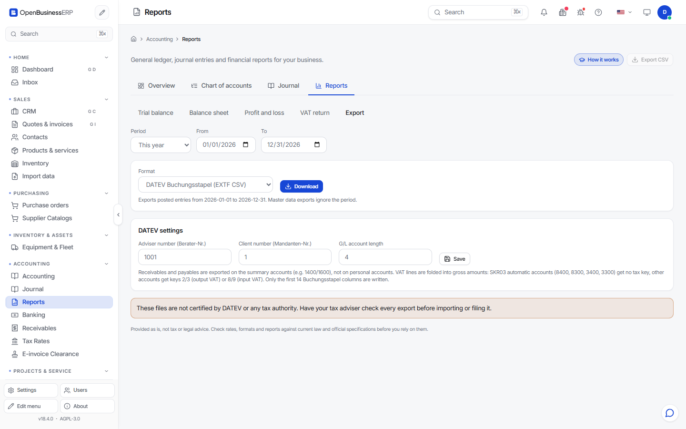

# DATEV and SAF-T export

You can hand your books to an accountant as files.

!!! warning "Not certified"
    The files are generated by this program. They are **not certified** by DATEV or by any tax authority. Send a test file to your tax adviser before the first real use. Schema-valid does not mean accepted.

## How to export

1. Open **Accounting** and find the export panel.
2. Pick the period. The export contains posted entries from the start date to the end date.
3. Pick the format and choose **Download**.

| Format | File | Use |
|---|---|---|
| DATEV Buchungsstapel | `EXTF_Buchungsstapel_<from>_<to>.csv` | Bookings, for DATEV import |
| DATEV Debitoren/Kreditoren | `EXTF_Debitoren_Kreditoren_<from>_<to>.csv` | Customer and supplier master data. Ignores the period. |
| SAF-T 2.0 | XML | Standard audit file: accounts, customers, suppliers, tax table, journal entries |

## DATEV settings

Before the first export, enter the numbers your adviser gives you:

| Setting | Allowed values | Default |
|---|---|---|
| Adviser number (Berater-Nr.) | 1001 to 9999999 | 1001 |
| Client number (Mandanten-Nr.) | 1 to 99999 | 1 |
| G/L account length | 4 to 8 | 4 |

The screen shows these three. The file `gl_export_settings.json` in the data directory also holds the chart key (`skr`, "03" or "04", default "03"). The defaults are placeholders. Wrong numbers make the import fail or land in the wrong client.

## Limits you must know

DATEV:

- Only the first 14 columns of the Buchungsstapel are written. DATEV reads by column position, so the 111 optional columns are left out. Fields in them (for example cost centres) are not exported.
- Receivables and payables are booked on the summary accounts (SKR03 1400 and 1600), not on personal accounts per customer or supplier. Your adviser may need to split them using the Debitoren/Kreditoren file.
- An entry with several lines is split into pairs of rows with the same document field.
- VAT lines on the SKR03 tax accounts 1571, 1576, 1771 and 1776 are folded into the net line, which then carries the gross amount. Net accounts that are automatic accounts (3300, 3400, 8300, 8400) get no tax key. Other accounts get the classic two-digit key. VAT lines that cannot be matched stay as separate rows.
- The file is encoded in Windows-1252, as DATEV expects.
- The program ships an SKR03 chart and an IFRS-style chart. It has no SKR04 chart. If your adviser works with SKR04, the account numbers in the file will not match.

SAF-T:

- The file follows the structure of SAF-T 2.0 in schema order. It is a general format. National variants (for example Norway, Poland, Portugal) have their own additional rules. The program does not implement them.
- The VAT tax table is built from the tax rates in your settings.

Both:

- Only posted entries are exported. Drafts are not.
- You are responsible for checking the file with your adviser or authority before you rely on it.
