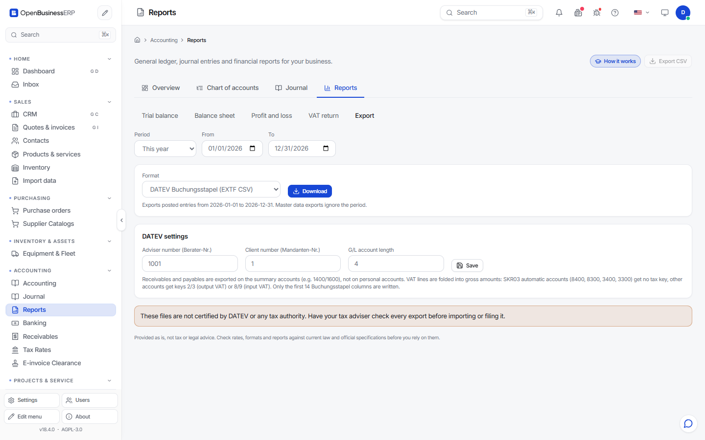

# DATEV and SAF-T export

You can hand your books to an accountant as files.

!!! warning "Not certified"
    The files are generated by this program. They are **not certified** by DATEV or by any tax authority. Send a test file to your tax adviser before the first real use. Schema-valid does not mean accepted.

## How to export

1. Open **Accounting** and find the export panel.
2. Pick the period. The export contains posted entries from the start date to the end date.
3. Pick the format and choose **Download**.

| Format | File | Use |
|---|---|---|
| DATEV Buchungsstapel | `EXTF_Buchungsstapel_<from>_<to>.csv` | Bookings, for DATEV import |
| DATEV Debitoren/Kreditoren | `EXTF_Debitoren_Kreditoren_<from>_<to>.csv` | Customer and supplier master data. Ignores the period. |
| SAF-T 2.0 | XML | Standard audit file: accounts, customers, suppliers, tax table, journal entries |

## DATEV settings

Before the first export, enter the numbers your adviser gives you:

| Setting | Allowed values | Default |
|---|---|---|
| Adviser number (Berater-Nr.) | 1001 to 9999999 | 1001 |
| Client number (Mandanten-Nr.) | 1 to 99999 | 1 |
| G/L account length | 4 to 8 | 4 |
| Customer accounts (Debitoren) from / to | number range | 10000 to 69999 |
| Supplier accounts (Kreditoren) from / to | number range | 70000 to 99999 |
| Initials (Diktatkürzel) | up to 2 characters | empty |
| Lock bookings on import (Festschreibung) | on / off | off |

The screen shows these settings. The file `gl_export_settings.json` in the data directory also holds the chart key (`skr`, "03" or "04", default "03"). The defaults are placeholders. Wrong numbers make the import fail or land in the wrong client.

## Limits you must know

DATEV:

- All 125 columns of the Buchungsstapel are written. Columns without a data source in the program (for example cost centres) stay empty.
- Receivables and payables of invoices, bills and their payments are booked on Debitor/Kreditor personal accounts. Entries without a known customer or supplier stay on the collective account (SKR03 1400 and 1600, SKR04 1200 and 3300).
- An entry with several lines is split into pairs of rows with the same document field.
- VAT lines on the tax accounts (SKR03 1571, 1576, 1771, 1776; SKR04 1401, 1406, 3801, 3806) are folded into the net line, which then carries the gross amount. Net accounts that are automatic accounts (SKR03 3300, 3400, 8300, 8400; SKR04 5300, 5400, 4300, 4400) get no tax key. Other accounts get the classic two-digit key. VAT lines that cannot be matched stay as separate rows.
- On SKR03, invoices and bills post per VAT rate: 19 % to 8400/1776 (purchases 3400/1576), 7 % to 8300/1771 (purchases 3300/1571). A 0 % invoice line goes to 8337 when the tax note names reverse charge or § 13b, to 8125 for an intra-community supply, to 8195 for a small business under § 19 UStG, and to 8100 otherwise. On SKR04 the same rules use 4400/3806 (purchases 5400/1406) for 19 %, 4300/3801 (purchases 5300/1401) for 7 %, and 4337, 4125, 4185 and 4100 for 0 %. Bills that clear a goods receipt keep the expense on the receipt account; only their input VAT is split.
- The file is encoded in Windows-1252, as DATEV expects.
- The program ships SKR03, SKR04, the Austrian EKR, the Swiss KMU chart and an IFRS-style chart. The DATEV export uses the SKR of the loaded German chart, so pick the chart your adviser works with before you start booking.

SAF-T:

- The file follows the structure of SAF-T 2.0 in schema order. It is a general format. National variants (for example Norway, Poland, Portugal) have their own additional rules. The program does not implement them.
- The VAT tax table is built from the tax rates in your settings.

Both:

- Only posted entries are exported. Drafts are not.
- You are responsible for checking the file with your adviser or authority before you rely on it.
