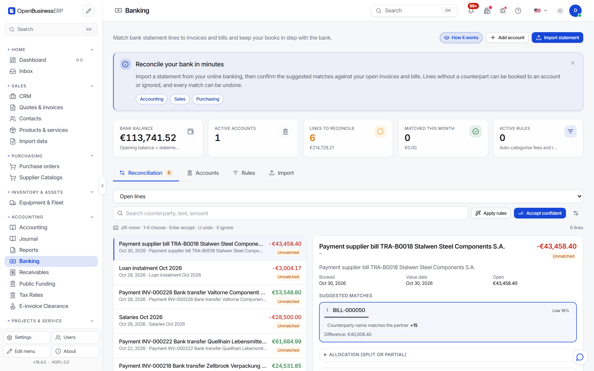

# Banking and reconciliation

The program does not connect to your bank. You download a statement file from your bank and import it. Then the program suggests which invoice or bill each line pays.

## Set up

1. Open **Banking** (`/banking`).
2. Add a bank account: name, IBAN, currency and the ledger account it maps to.
3. Optional: enter the opening balance.

## Import a statement

Choose the account, then upload the file. Supported formats:

| Format | Notes |
|---|---|
| camt.053 and camt.054 | ISO 20022 XML. Most European banks offer it. |
| MT940 | SWIFT text format. |
| CSV | You map the columns. Available fields: date, value date, amount (or debit and credit), currency, counterparty name and IBAN, remittance text, reference. |

The program detects the format. Before importing, it shows a preview. Lines that are already in the system are skipped, so importing an overlapping statement does not create duplicates.

## Review the matches

Each line without a match gets suggestions. A suggestion shows a score from 0 to 1 and the reasons for it. The score adds up these signals:

| Signal | Weight |
|---|---|
| Amount equals the open amount | 0.40 (0.30 within tolerance, 0.10 for a partial payment) |
| Document number appears in the payment reference | 0.35 |
| Customer or supplier name appears in the line | 0.15 |
| The sender's IBAN paid an earlier matched invoice | 0.20 |
| Booking date is near the due or document date | up to 0.10 |

The total is capped at 1.0. The program can also suggest a split of up to three open items of one partner that add up to the bank amount.

For each line you can:

- **Confirm** a suggestion. The program records the payment on the invoice or bill and posts it. Customer receipts go through the same payment function as a payment you would enter by hand.
- **Book manually**, to an account of your choice, for fees, interest or private withdrawals.
- **Ignore** the line.
- **Undo** a confirmation.

Several clear matches can be accepted in one step with bulk accept.

## Rules

If the same kind of line comes up every month, create a rule from it. For example, a line from your payment provider can always go to the fees account. Run **Apply rules** after an import.

## Limits

- No direct bank feed (no PSD2 or other live connection). You import files.
- Suggestions are suggestions. Check amount and partner before you confirm, especially for split payments.
- Foreign-currency payments need an exchange rate for the payment date. See [Multi-currency](multi-currency.md).
