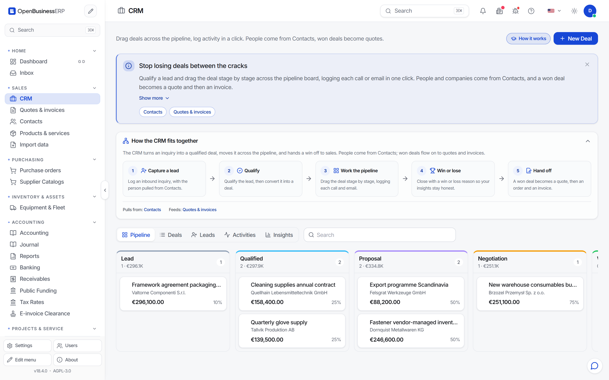

# Customers and CRM

## Customers and suppliers

Customers and suppliers are kept as contacts (`/contacts`). A contact has a name, address, email, tax number and, for suppliers, bank details. The same contact record is used on quotes, invoices, purchase orders and bills.

You can create a customer in three ways:

- In the contacts list.
- Directly on a quote or invoice, by typing the name.
- With the import wizard, from a CSV or XLSX file.

Keep names and addresses complete. An invoice cannot be issued without the customer's name and address.

## The pipeline

The CRM (`/crm`) shows opportunities as a board. An opportunity is a possible sale: who, how much, and how likely.

The default stages are:

| Stage | Default probability |
|---|---|
| Lead | 10 % |
| Qualified | 25 % |
| Proposal | 50 % |
| Negotiation | 75 % |
| Won | 100 % |
| Lost | 0 % |

You move an opportunity by dragging the card to another column. Each move is logged with a date. Won and Lost are final stages. When you close an opportunity you can record a reason, chosen from a list of win and loss reasons.

The weighted value of the board is the sum of amount times probability. Treat it as an estimate. It is only as good as the probabilities you maintain.

## From opportunity to quote

When the customer asks for a price, create a quote for the same customer. Continue in [Quote, order, delivery, invoice](sales-flow.md).

## Limits

- Stages and probabilities are stored in the database and can be changed through the API (`/api/v1/crm/pipeline-stages/`). The six default stages are a starting point.
- CRM and sales are separate modules. You create the quote yourself.
