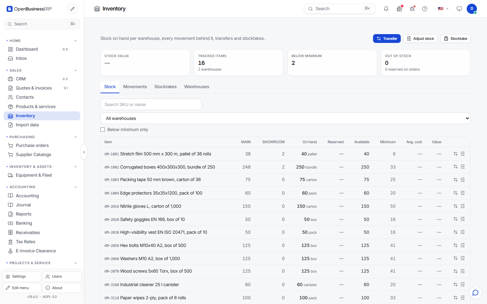

# Purchasing and inventory

## Purchasing

The purchasing flow mirrors sales:

| Step | What you do | What the program does |
|---|---|---|
| Purchase order (`PO`) | Create it for a supplier, add lines, confirm. | Nothing is booked yet. |
| Goods receipt (`GR`) | On the confirmed order, choose **Receive**. You can receive part of the quantity. | Stock goes up. The value is booked as inventory against "goods received, not invoiced" (GRNI). |
| Bill (`BILL`) | Enter the supplier invoice, or create the bill from the order or receipt. Then **Post**. | Clears GRNI, books input VAT and the payable. |
| Payment | Record the payment on the bill. | Clears the payable against the bank account. |

Order states: draft, confirmed, partially received, received, closed, cancelled.

### Three-way match

When you post a bill, the program compares it with the order and the receipt. It flags each line as a quantity variance if you bill more than you received and have not yet billed, and as a price variance if the bill price differs from the order price. The flags are warnings for you to check. They are not blocks.

### Credit notes from suppliers

A supplier credit note is entered like a bill, as a document of type credit note (`CN`).

### Account mapping

Purchasing posts to accounts by role: inventory, GRNI, expense, input VAT, payables and bank. The defaults match the chart you chose (SKR03 or IFRS). You can change the mapping in the purchasing settings.

## Inventory

Inventory shows stock per product and warehouse, with minimum levels.

- **Warehouses.** One default warehouse is created for you. Add more if you need them.
- **Movements.** Every change in stock is a movement: receipt, delivery, transfer, adjustment. The movement list is the history of every quantity.
- **Transfers.** Move stock between warehouses. This changes quantities only. It posts nothing to the ledger.
- **Adjustments.** Correct a quantity, for example for breakage.
- **Stocktakes.** Start a count, enter the counted quantities, then **Post**. The differences become adjustments, and their value is booked to an inventory-difference account. A stocktake can be cancelled before posting.

### How stock is valued

The program uses a moving average cost per product, across all warehouses. A receipt blends its cost into the average. A delivery leaves at the current average. All values are in your base currency.

There is no FIFO or LIFO option. If your tax rules need one of them, this program does not do it today.

### Opening stock

Enter starting quantities as an opening adjustment. It changes quantities and cost only and posts no ledger entry. Book the matching value through the opening balances of your accounts. The opening balances in the import wizard are ledger balances. They do not load stock quantities.

### Products

Products and services are in the catalogue (`/items`). Services have no stock. See the picture below for margins and stock columns.

