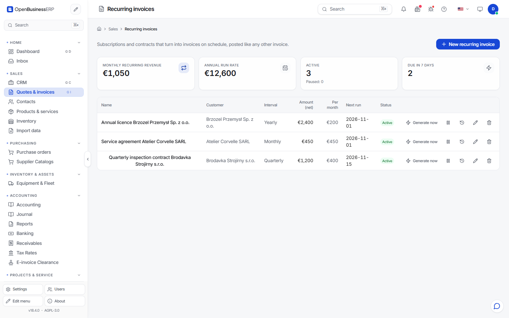

# Recurring invoices

Use a recurring invoice for work you bill on a fixed schedule: a retainer, a subscription, rent, maintenance.

## How it works

You create a template at **Sales > Recurring** (`/sales/recurring`). A template holds the customer, the lines and a schedule. On each due date the program creates an invoice from the template.

| Setting | Options |
|---|---|
| Interval | weekly, monthly, quarterly, yearly |
| Every | a number of intervals, for example every 2 months |
| Auto-issue | on by default. The generated invoice is issued and posted. With it off, you get a draft to review. |
| Auto-send | off by default. When on, the issued invoice is emailed to the customer. |

A template is **active**, **paused** or **ended**. Pause it when the customer is on holiday or in dispute. Resume it later.

The page shows MRR and ARR for the active templates. These are the monthly and yearly recurring revenue, computed from the template amounts.

## Rules you should know

- **One invoice per period.** Each template and period can produce an invoice only once. Running the generator twice does not create duplicates.
- **Catch-up is capped.** If the program was off for a long time, one run creates at most 24 missed invoices per template.
- **Run now.** You can generate the next invoice by hand with **Generate**, or run all due templates with **Run due**.
- **Check the run log.** Each run records its result: generated, issued, sent, send failed or failed. Look for `send_failed` after you switch on auto-send. A common cause is missing mail settings.

## Start with auto-send off

For the first two or three cycles, leave auto-send off. Review the issued invoices. Switch it on when the output is right.

## Changing a price

Edit the template. The change applies to future invoices only. Invoices already issued stay as they are.
