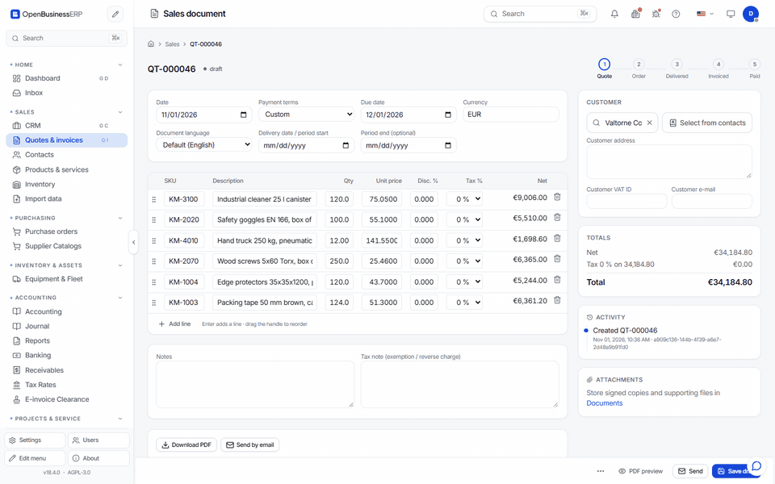

# Quote, order, delivery, invoice

A sale moves through up to four documents. Each is created from the one before, so lines and prices carry over. You can start at any step: an invoice does not need a quote.

## The documents and their states

| Document | Number prefix | States |
|---|---|---|
| Quote | `QT` | draft, sent, accepted, rejected, expired, cancelled, converted |
| Order | `SO` | draft, confirmed, delivered, invoiced, cancelled |
| Invoice | `INV` | draft, issued, partially paid, paid, cancelled |
| Credit note | `CN` | draft, issued, cancelled |

The prefix of invoices can be changed in the setup wizard or in Settings.

## Step by step

### 1. Quote

Open **Sales**, choose **New quote**, pick the customer and add lines. Each line has a description, quantity, unit price and VAT rate. You can pick products from the catalogue. Save the draft.

Send the quote by email or download the PDF. Sending a draft quote sets it to **sent**. Mark it **accepted** when the customer agrees.

### 2. Order

On an accepted quote, choose **Convert to order**. The quote becomes **converted** and the order opens as a draft with the same lines. Confirm the order when you commit to deliver.

### 3. Delivery

On a confirmed order, set the status to **delivered** when the goods have left.

If the lines are stock products, delivery takes the goods out of the warehouse and books the cost of goods sold at the current average cost. See [Purchasing and inventory](purchasing-inventory.md). Cancelling a delivered order puts the stock back.

Services need no delivery. You can go from **confirmed** straight to invoicing.

### 4. Invoice

On a confirmed or delivered order, choose **Convert to invoice**. The invoice opens as a draft. Check the PDF, then **Issue**. Issuing posts the invoice to the ledger. See [Set up and send your first invoice](first-invoice.md).

Partial invoicing works. The order keeps track of how much is not yet invoiced.

### 5. Send

Choose **Send** on the invoice. The program shows an email draft with the PDF attached. Edit the text if you want, then send. Every send is logged on the document. See [Email and PDF templates](templates.md).

### 6. Payment

Record a payment on the invoice: amount, date, method and reference. A partial payment moves the invoice to **partially paid**. The full amount moves it to **paid**.

You rarely need to type payments by hand. Import the bank statement and confirm the suggested match. See [Banking and reconciliation](banking.md).

## Corrections

- A draft can be edited or deleted.
- An issued invoice cannot be edited. Cancel it, which reverses the ledger entry, or issue a **credit note** against it. A credit note credits the lines you choose and posts the reversal for them.
- Quotes that nobody answers can be set to **expired**.

## Duplicate

**Duplicate** copies a document as a new draft. Use it for repeat orders. For a fixed schedule, use [Recurring invoices](recurring.md).

## Watch the flow

